# Tech Review App

Android technology-review application created for the Mobile Computing course at Pontificia Universidad Javeriana.

The application is envisioned as a small social network where people can discover technology products, rate them, and share reviews with the community.

Backend REST repository: [tech-review-app-backend](https://github.com/CarefreeHarp/tech-review-app-backend).

## Design

### Interface prototype

The Devicers interface prototype is available on <a href="https://www.figma.com/design/l7mETjAKWkyAFwtx1VWmIX/Untitled?node-id=1-484&amp;t=p0lttPj7kJNiSUG2-1" target="_blank" rel="noopener noreferrer">Figma</a>.

| Access                                                                                | Register                                                                                      | Home                                                                              | Search products                                                                                       |
| ------------------------------------------------------------------------------------- | --------------------------------------------------------------------------------------------- | --------------------------------------------------------------------------------- | ----------------------------------------------------------------------------------------------------- |
| 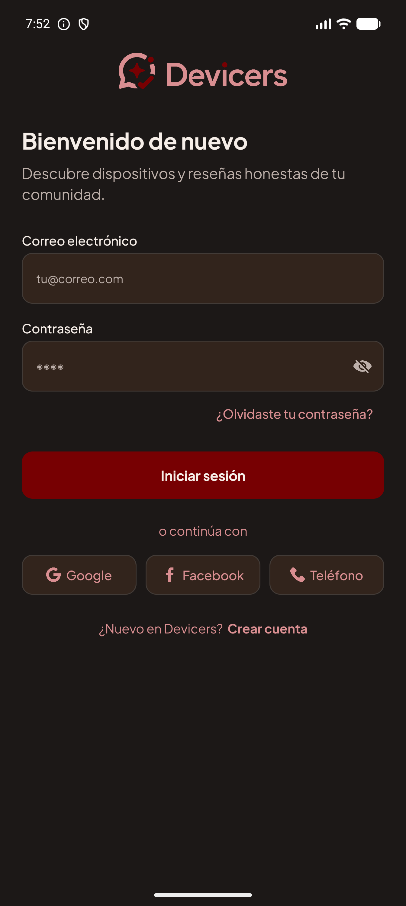 | 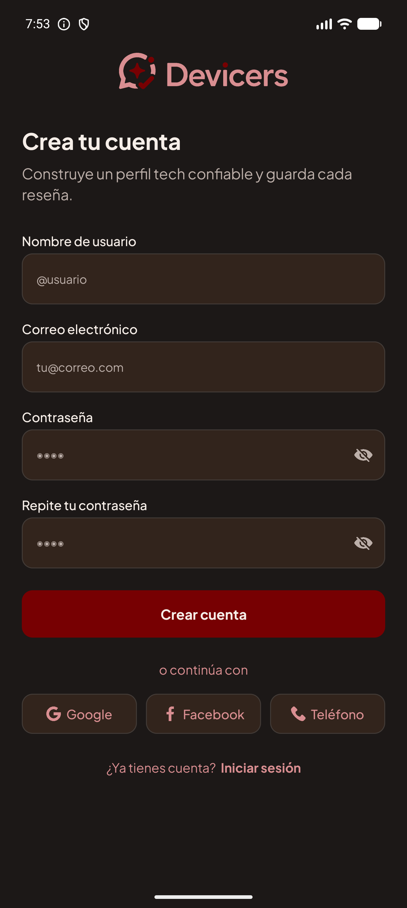 | 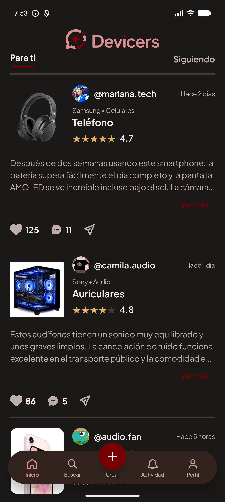 | 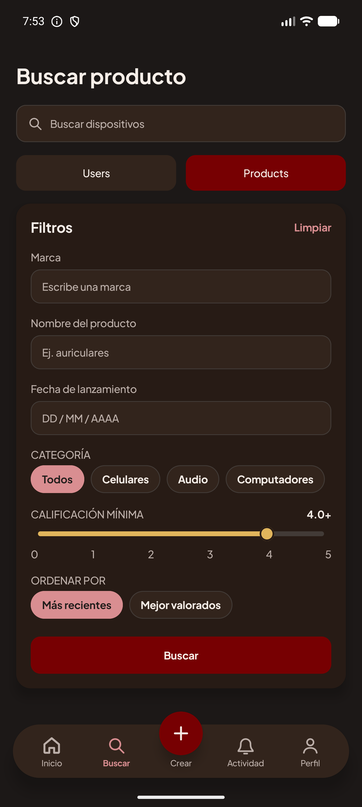 |

| Create review                                                                                      | Activity                                                                                  | Own profile                                                                                    | Search profiles                                                                                      |
| -------------------------------------------------------------------------------------------------- | ----------------------------------------------------------------------------------------- | ---------------------------------------------------------------------------------------------- | ---------------------------------------------------------------------------------------------------- |
| 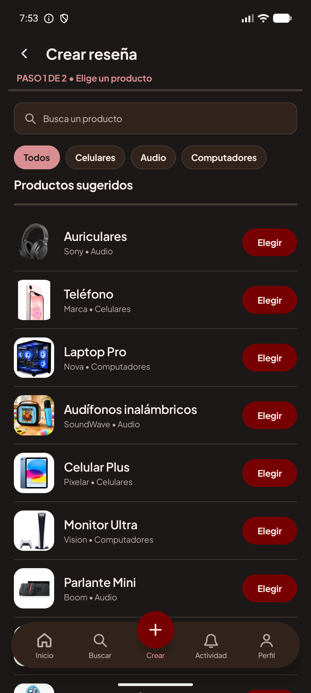 | 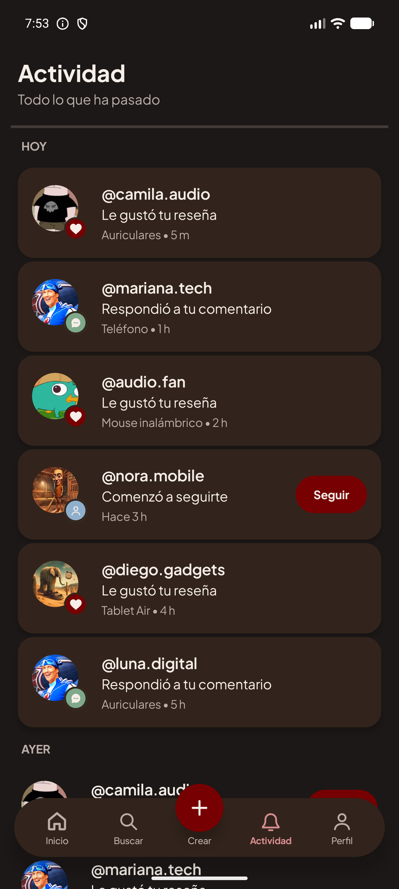 | 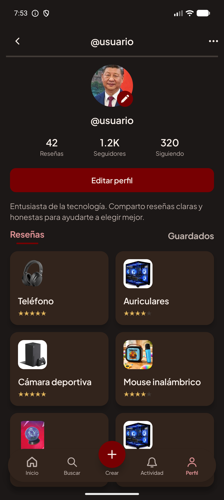 | 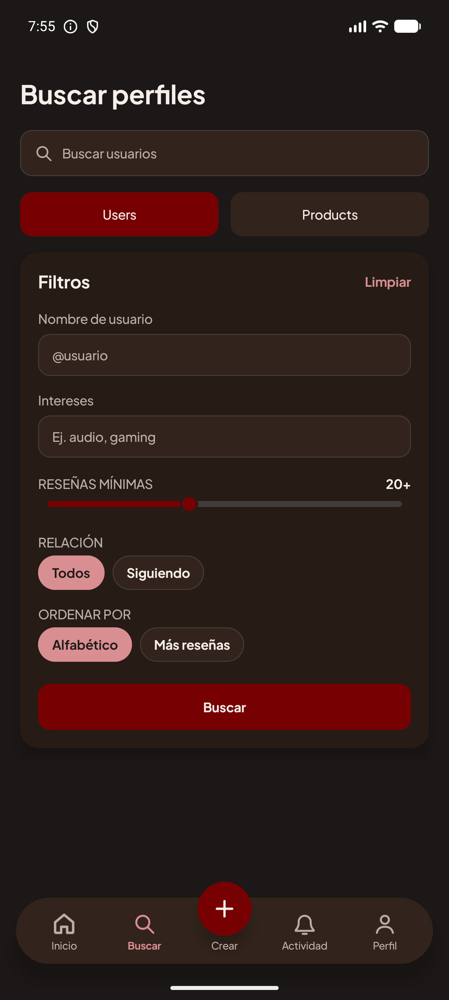 |

| Found products                                                                                       | Profile results                                                                                                     | Saved reviews                                                                                             | Request product                                                                                        |
| ---------------------------------------------------------------------------------------------------- | ------------------------------------------------------------------------------------------------------------------- | --------------------------------------------------------------------------------------------------------- | ------------------------------------------------------------------------------------------------------ |
| 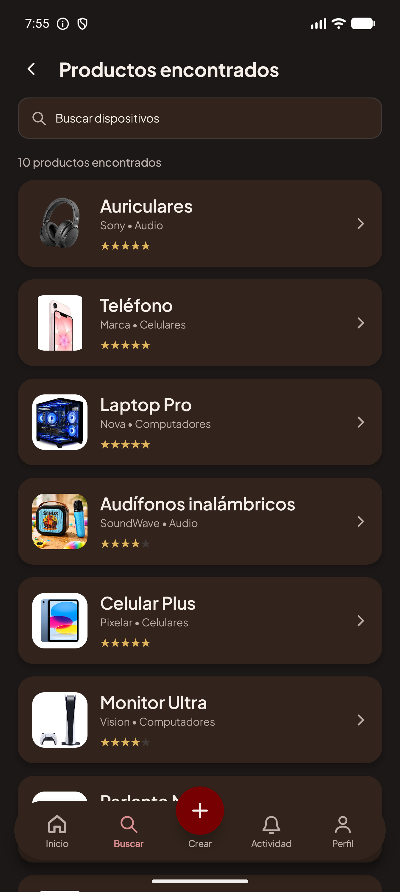 | 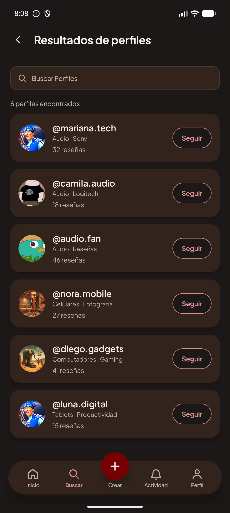 | 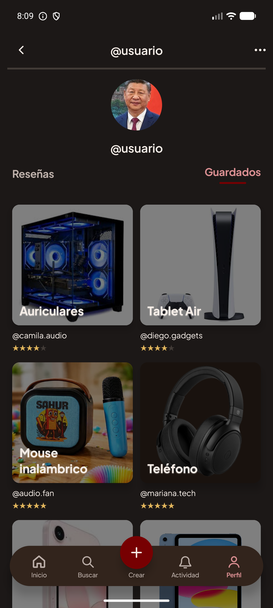 | 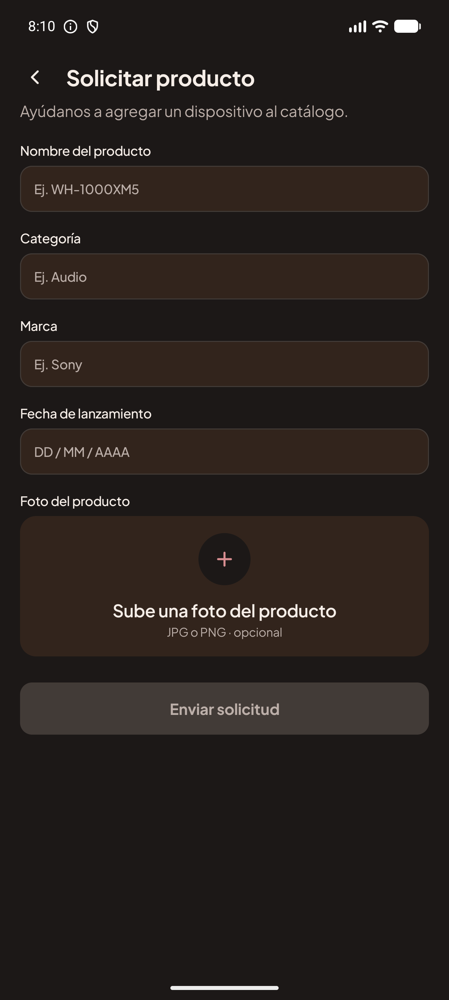 |

| Product                                                                                        | Rate product                                                                                     | Review                                                                                       | Public profile                                                                                       |
| ---------------------------------------------------------------------------------------------- | ------------------------------------------------------------------------------------------------ | -------------------------------------------------------------------------------------------- | ---------------------------------------------------------------------------------------------------- |
| 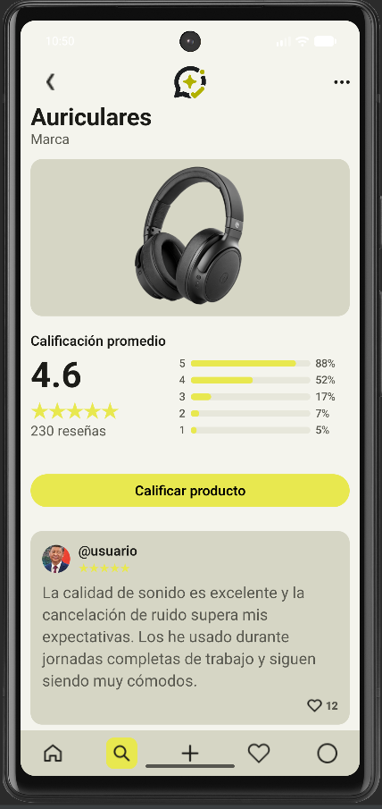 | 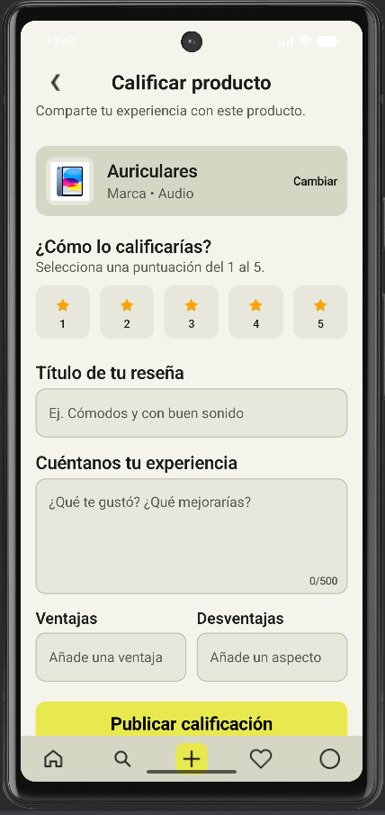 | 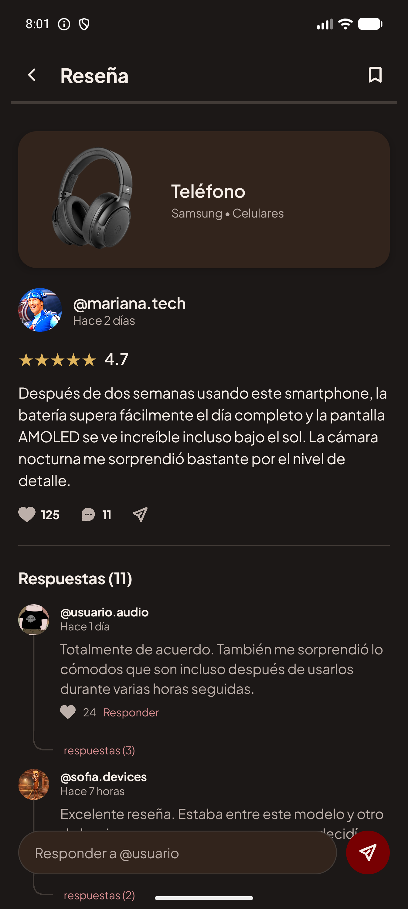 | 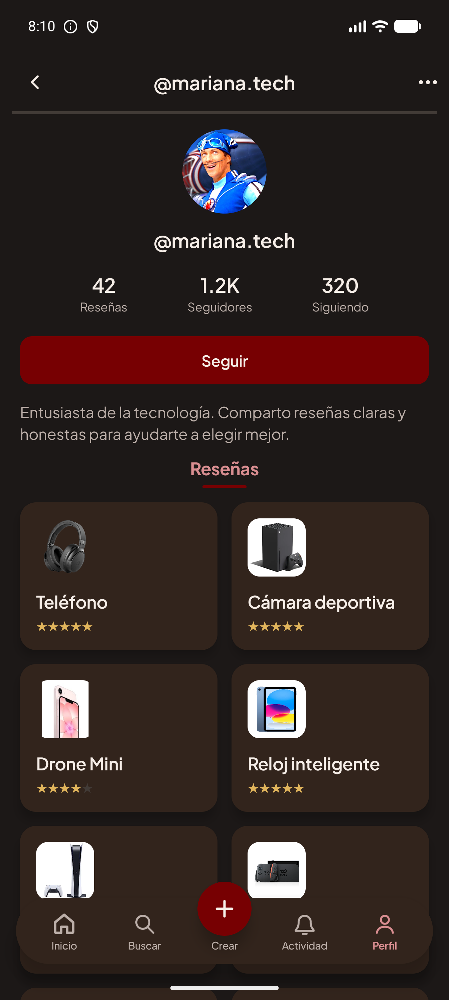 |

### Logos

| Light logo                                                                                           | Dark logo                                                                                          |
| ---------------------------------------------------------------------------------------------------- | -------------------------------------------------------------------------------------------------- |
|  |  |

## Navigation map

[Download the interactive navigation map here](ReadMeAssets/Sprint4NavigationDiagram.html)

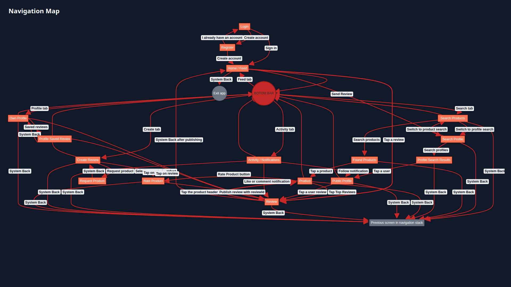

### Navigation conventions

- **Red routes** represent the navigation actions between the current screens; the adjacent label names the action that triggers each transition.
- **Orange nodes** represent the application screens and **gray nodes** represent navigation-system outcomes, such as exiting the application or returning to the prior screen.
- The Bottom bar leads to Home / Feed, Search Products, Create Review, Activity / Notifications, and Own Profile. Rate Product does not display it.
- System Back exits the application from Home / Feed. From every other destination it returns to the previous entry in the navigation stack.

## Data model

## Object-oriented class diagram

> The diagram is an SVG vector image. Download it or open it directly in a browser to zoom in and inspect the relationships without losing quality.


### Express / PostgreSQL relational database

The REST backend stores related entities in PostgreSQL tables. The diagram below describes its relational schema.


### Firebase / Cloud Firestore database

Firestore stores the main entities as collections and growing relationships as subcollections. Solid green arrows indicate subcollections; dotted arrows indicate references by ID.


`counters/next_id` groups the next numeric IDs in `next_user_id` and `next_review_id`. Reviews keep `likes_count` and `comments_count`; articles keep `stores_count`. Users keep `followers_count`, `follows_count` and `review_bookmarks_count`, and comments keep `likes_count`. These fields count direct documents in each subcollection.

Both diagrams are SVG vector images. Open either image directly to zoom in without losing quality.

## Functional requirements

- **FR-01 to FR-04 — Authentication:** create an account with an email address, username, and password; sign in; and restrict features to registered users.
- **FR-05 and FR-06 — Feed:** show reviews from followed accounts, ordered from newest to oldest.
- **FR-07 to FR-11 and FR-30 to FR-32 — Product discovery:** browse products by categories and subcategories; filter by subcategory or brand; search, select, and view product details; and access stores where a product is available.
- **FR-25, FR-26, and FR-33 to FR-36 — Community reviews:** show reviews from other users with author, date, rating, likes, and access to the author's profile; users can hide or delete their own reviews and manage review likes.
- **FR-12 to FR-16 — Ratings and reviews:** rate products using integer values from 0 to 5, write an analysis, allow only one review per user and product, and allow later edits.
- **FR-17, FR-27, FR-28, and FR-37 to FR-40 — Comments:** comment on other users' analyses, including users who are not followed; reply to, edit, hide, or delete own comments; and manage comment likes.
- **FR-29 and FR-44 to FR-45 — Following:** follow or unfollow users, view followers and followed users, and prevent self-following.
- **FR-18 to FR-20 — Profile:** update profile information and photo, delete the account, and view all products rated by the user.
- **FR-21 to FR-23 — Notifications:** notify users about new followers, comments on their reviews, and likes on their reviews.
- **FR-24 — Review reading:** select a review from the feed to view its full content.
- **FR-41 to FR-43 and FR-46 to FR-47 — Account and saved content:** save reviews, view saved reviews, view public profile details, sign out, and hide content without permanently deleting it.

## Technical scope

The application uses MVVM, repositories and Hilt dependency injection. General data comes from either Cloud Firestore or the Express REST API backed by SQL. Firebase Authentication and Storage are shared by both modes.

### Authentication and profiles

Firebase Authentication owns the session in both backend modes. `Utils.getCurrentUser()` and `Utils.getCurrentUserId()` read the authenticated account directly; Splash routes to Home when it exists. Screens resolve the Firebase UID to the numeric database user ID through `UserRepository.getAuthenticatedUser()`. There is no SessionState, SessionViewModel or SessionRepository.

Registration validates the username, email and passwords before creating the Auth account, then creates its profile through the selected data source. Firestore allocates numeric IDs transactionally through `counters/next_id.next_user_id`; Express uses the SQL sequence. Passwords remain exclusively in Auth. Profiles are not automatically copied between Firestore and SQL when switching implementations.

User-specific reads, review creation and ownership checks use the numeric database ID. Opening that user's profile routes to OwnProfile; another user's ID routes to public Profile. Both obtain profile information and active reviews from the selected repositories. Review removal is logical (`is_active = false`) in both modes.

Every profile photo uses the shared `ProfileAvatar` and the selected database's `profile_image_url`. Comments preserve their stored author photo; when it is absent, their unique author IDs are resolved through the selected user data source. Missing photos use `no_pfp_icon`; failed downloads use `pfp_error`.

### Profile editing

OwnProfile exposes Edit profile in the header position occupied by Follow on public profiles. Its right sidebar provides Edit profile, Saved reviews, Preferences and Sign out. Editing and saved reviews each have two entry points. The photo pencil appears only in EditProfile.

EditProfile receives no user ID from navigation: it resolves the authenticated account through `UserRepository`. Username and biography are editable; email is read-only. Cancel discards the draft. Saving writes profile fields through Firestore or Express; selecting a new photo first uploads it to Firebase Storage and then saves its URL. Upload failures retain the draft and report an error. Auth and Storage remain Firebase services in Retrofit mode.

### Follow lists and preferences

Followers and Following metrics open FollowList with the displayed profile ID and selected tab. The selected tab is highlighted, but relation queries and actions are intentionally disconnected. FollowList, Home's Following tab and Activity's notifications stay empty. Like and Follow controls retain their presentation without database actions. Existing saved reviews can still be read; the bookmark button does not create new saved records.

UserPreferences displays its header, back navigation, divider and placeholder message. It has no preference controls, user arguments or remote data source. Posting comments and the other unfinished placeholder actions have not been enabled by this refactor.

## Refactor de datos: Firestore y Express

La selección global se configura en [`BackendConfig.kt`](DevicersApp/app/src/main/java/com/example/devicersapp/data/config/BackendConfig.kt), cambiando `USE_FIRESTORE`: `true` para Firestore y `false` para Retrofit. Después de cambiarlo, vuelve a compilar y ejecutar. Consulta la [arquitectura, contraste de entidades y adaptación de UI](docs/DataLayerRefactor.md).

La UI está adaptada a los repositorios y modelos agrupados, y el APK compila con Firestore y Retrofit. Likes y seguimientos conservan sus pantallas y controles visuales, pero no ejecutan consultas ni escrituras. Activity conserva su diseño sin cargar notificaciones; la pestaña Siguiendo y FollowList permanecen vacías.

La autenticación usa directamente la sesión mantenida por Firebase Auth mediante `Utils.getCurrentUser()` y `getCurrentUserId()`. Auth y Storage siguen en Firebase al elegir Retrofit. Se retiraron SessionState, SessionViewModel y SessionRepository; cada pantalla consulta su perfil cuando lo necesita.
